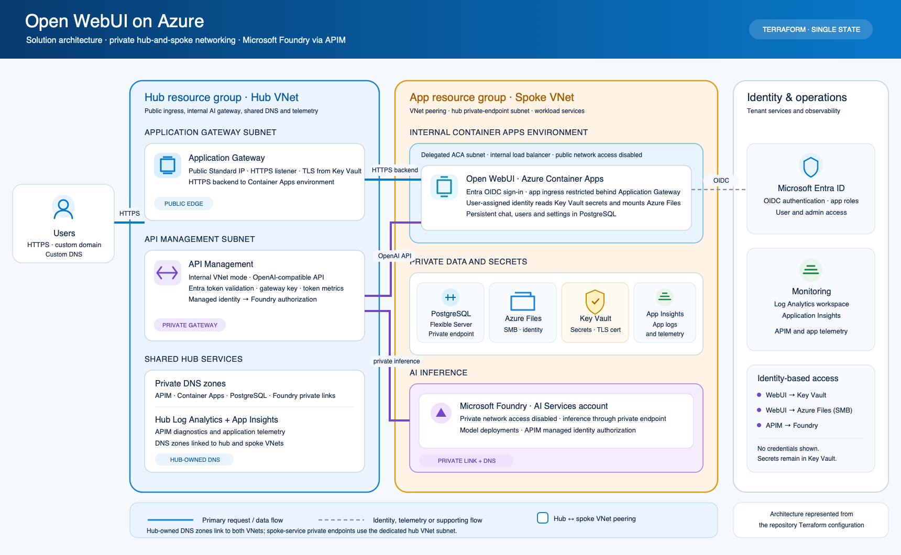
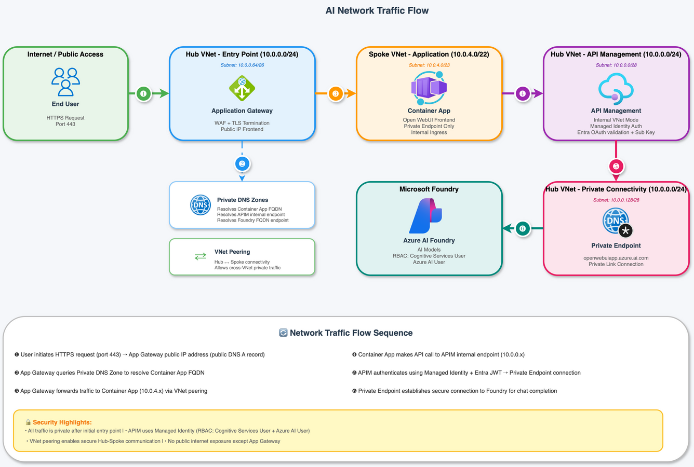

# Open WebUI on Azure - Production Grade Quickstart

Deploy [Open WebUI](https://github.com/open-webui/open-webui) on Azure Container Apps with Entra ID authentication, Azure API Management (AI API Gateway), Microsoft (Azure) Foundry integration, and Application Gateway.

## Architecture




## Features

- **Open WebUI** on Azure Container Apps with OAuth/OIDC Entra ID integration
- **Microsoft Foundry** with multiple models accessed through API Management
- **Application Gateway** with a custom domain and HTTPS
- **API Management** with token validation, limits, and usage metrics
- **Azure PostgreSQL Database** for persistent users, chats, and settings
- **Terraform** infrastructure in a single root module and state, with a GitHub Actions deployment
- Internal ingress and private endpoints for the application infrastructure

> [!NOTE]
> The Azure Files SMB mount uses [managed identity authentication (preview)](https://learn.microsoft.com/en-us/azure/container-apps/storage-mounts#azure-files). PostgreSQL uses password authentication.

## Prerequisites

- Terraform >= 1.11 and Azure CLI, signed in to the target subscription
- Owner access, or Contributor plus User Access Administrator, and permission to create Entra ID app registrations
- An Azure Storage account and container for Terraform state, with appropriate Entra ID access
- A custom domain and access to its DNS records
- A publicly trusted TLS certificate for the custom domain. By default Terraform buys an [App Service Certificate](https://learn.microsoft.com/en-us/azure/app-service/configure-ssl-app-service-certificate) (about USD 70/year, issued by GoDaddy) and stores and renews it in the spoke Key Vault. Alternatively, set `use_app_service_certificate = false` and supply your own PFX. Application Gateway uses the certificate for the public HTTPS listener and validates the same certificate on the Container App backend against well-known public CAs

## Deployment

The hub and app resources are deployed from one Terraform root module, `infra/terraform/app`, with a single state file. Review `infra/terraform/app/terraform.tfvars` before deployment. The certificate secret name is derived automatically and shared by the Container Apps environment and Application Gateway; override it with `certificate_name` if needed.

### Resource naming

Most Azure resource names follow `<type>-<workload>-<environment>-<region>-<instance>` with [Cloud Adoption Framework abbreviations](https://learn.microsoft.com/en-us/azure/cloud-adoption-framework/ready/azure-best-practices/resource-abbreviations), for example `rg-owui-demo-uks-01` and `agw-owui-hub-demo-uks-01`. The workload abbreviation comes from `workload` for app resources (for example `owui`) and `hub_workload` for hub resources (for example `owui-hub`); the region abbreviation is derived from `location` unless `location_short` is set. Globally unique names (Key Vault, Storage, PostgreSQL, APIM and the Foundry subdomain) get a short suffix derived from the subscription, for example `kv-owui-demo-uks-01-1a2b` and `stowuidemouks011a2b`. The [`naming` module](infra/terraform/modules/naming) builds the names. Required DNS zone names, APIM policy identifiers and Terraform resource labels are intentionally unchanged.

The hub uses `location` and `location_short` unless `hub_location` (and optionally `hub_location_short`) deploy it to a different region. An explicit `location_short` is required for regions without a built-in abbreviation.

Changing naming inputs after deployment can replace resources, including the Azure Files share containing application data. Review the plan and migrate data before applying such changes.

The commands below run from the repository root. See the [Terraform deployment guide](infra/terraform/README.md) for backend setup, secret handling, and [GitHub Actions](infra/terraform/README.md#cicd-with-github-actions) deployment.

### 1. Deploy

Supply the PostgreSQL password and stable Open WebUI signing key through environment variables. The signing key must be at least 32 characters and must be reused for subsequent deployments.

```bash
export TF_VAR_postgres_admin_password='<strong-password>'
export TF_VAR_webui_secret_key='<stable-random-secret-at-least-32-characters>'

terraform -chdir=infra/terraform/app init \
  -backend-config="storage_account_name=<state-account>" \
  -backend-config="container_name=<state-container>" \
  -backend-config="key=openwebui.tfstate" \
  -backend-config="use_azuread_auth=true"
terraform -chdir=infra/terraform/app apply
terraform -chdir=infra/terraform/app output
```

APIM provisioning can take 30-45 minutes. Point the public domain to the `app_gateway_public_ip` output with an A record at your DNS provider, for example an Azure DNS public zone.

In PowerShell, set the variables below and enter multiline Terraform commands on one line:

```powershell
$env:TF_VAR_postgres_admin_password = '<strong-password>'
$env:TF_VAR_webui_secret_key = '<stable-random-secret-at-least-32-characters>'
```

#### TLS certificate

With `use_app_service_certificate = true`, the apply:

1. Orders the App Service Certificate for `custom_domain`. **This purchases the certificate and charges the subscription.**
2. Grants the `Microsoft.Azure.CertificateRegistration` service principal **Key Vault Secrets Officer** on the spoke Key Vault and binds the order to the generated certificate secret (or the `certificate_name` override).
3. Verifies domain ownership with a TXT record named `@` at the root domain. If `public_dns_zone_name` is an Azure DNS zone, Terraform creates the record (the deploying identity needs DNS Zone Contributor on it). Terraform triggers verification and retries for up to 30 minutes; with external DNS, add the TXT record at your provider while it retries.
4. Waits until the issued certificate is stored in Key Vault (polling with the Azure CLI, up to 60 minutes), then creates the Container Apps environment certificate and the Application Gateway HTTPS listener.

Before applying, make sure that:

- The `Microsoft.CertificateRegistration` resource provider is registered: `az provider register --namespace Microsoft.CertificateRegistration`.
- Any CAA records on the domain allow GoDaddy (`0 issue "godaddy.com"`).
- The root zone has no existing `@` TXT record set when Terraform manages it. If one exists (for example SPF), import it or add the token to it yourself.

With external DNS, read the token while the apply retries verification and add the TXT record at your DNS provider:

```bash
az resource show --resource-group <app-rg> --resource-type Microsoft.CertificateRegistration/certificateOrders \
  --name cert<workload><environment><region><instance> --query properties.domainVerificationToken -o tsv
```

If the wait times out, add or fix the TXT record and rerun the apply. Renewals can require verification again, so keep the TXT record in place. Removing the order from Terraform cancels the certificate. The issuance wait runs the Azure CLI through a POSIX shell, so apply from an environment where `az` is signed in (macOS, Linux, WSL or Git Bash).

To bring your own certificate instead, set `use_app_service_certificate = false` and supply `TF_VAR_certificate_pfx_base64` (or import the certificate into the spoke Key Vault before applying). The secret name is `cert-<workload>-<environment>-<region>-<instance>` unless overridden by `certificate_name`; after deployment, `terraform -chdir=infra/terraform/app output -raw certificate_name` shows it.

The Container App custom domain also requires DNS verification; prepare the `asuid` TXT and applicable CNAME/A records as described in the [Container Apps custom-domain documentation](https://learn.microsoft.com/en-us/azure/container-apps/custom-domains-certificates). After a successful apply, `terraform -chdir=infra/terraform/app output dns_records` lists every record to create at an external DNS provider (the A record, the certificate verification TXT record and the `asuid` TXT record).

Admin consent for the delegated permissions and the group-based `user`/`admin` app role assignments (`open_webui_user_group_name` / `open_webui_admin_group_name`) are managed by Terraform; the deploying identity needs the **DelegatedPermissionGrant.ReadWrite.All** Microsoft Graph permission. Assign additional users or groups to the `app-<workload>-<environment>-<region>-<instance>` enterprise application as appropriate — sign-in requires the `user` or `admin` app role.

### 2. Import the OpenAI API

For manual deployments, import the operations from the OpenAPI definition into APIM:

```bash
az apim api import --resource-group <hub-rg> --service-name <apim-name> \
  --api-id openai --path "openai/v1" --specification-format OpenApiJson \
  --specification-path infra/terraform/assets/openai.openapi.json \
  --display-name "Azure OpenAI v1 API" --protocols https --subscription-required false
```

The GitHub Actions deployment performs this import automatically after the apply.

## Configuration

### Optional Databalance theme

An optional custom image adds a Databalance-inspired purple, cyan, and neutral palette while retaining Open WebUI's name and logo. The upstream image remains the default. The CSS uses system fonts and does not bundle Databalance assets or fonts.

Build and publish the image to a registry accessible by Azure Container Apps:

```bash
docker buildx build --platform linux/amd64 \
  -t <registry>/<repository>/open-webui-databalance:v0.13.0 \
  --push ./infra/docker/openwebui
```

Set `open_webui_image` in `infra/terraform/app/terraform.tfvars` to the published image before applying. No container registry is provisioned by this repository; ensure Container Apps can pull the image.

### Connect Open WebUI to Microsoft Foundry (via APIM)

1. Navigate to Open WebUI and log in with Entra ID.
2. Go to **Admin Settings** → **Connections**.
3. Add an OpenAI-compatible connection with the API base URL `https://<apim-name>.azure-api.net/openai/v1`, the APIM subscription key in the `api-key` header, OAuth authentication, and the deployed model IDs.
